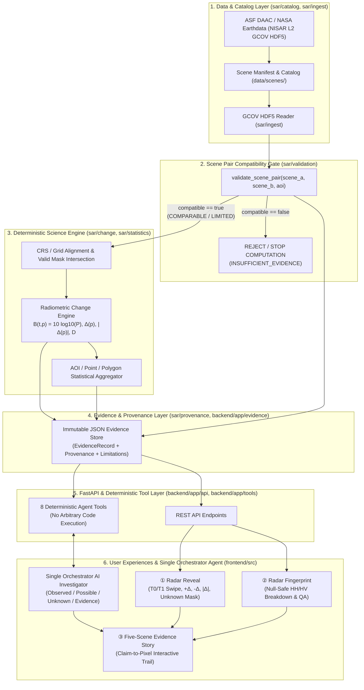
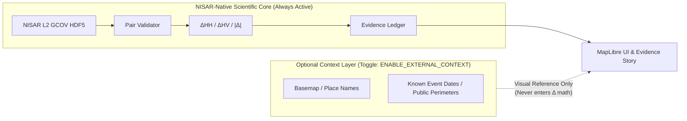

# SAR2Action — System Architecture

> **Design Principle:** Build from science outward (`DATA → VALIDATION → SCIENCE → EVIDENCE → API → MAP → AGENT → STORY`).  
> **Core Invariant:** Every quantitative claim displayed in the UI or uttered by the AI Investigator must resolve to an immutable `EvidenceRecord` computed deterministically from validated NISAR L-band Level-2 GCOV observations.

---

## 1. High-Level Data & Control Flow

---

## 2. Layer-by-Layer Architecture

### 2.1 Layer 1 — SAR Data & Catalog (`sar/catalog`, `sar/ingest`)
- **Scene Catalog (`sar/catalog`)**:
  - Maintains `scene_manifest.json` indexing candidate NISAR L-band Level-2 GCOV granules across candidate AOIs (Case A, Case B, Case C).
  - Records granule ID, acquisition start/stop UTC, orbit number, track/frame, pass direction (`Ascending` / `Descending`), look direction (`Left` / `Right`), product maturity, Composite Release ID (`CRID`), available frequency groups (`frequencyA`, `frequencyB`), available diagonal covariance terms (`HHHH`, `HVHV`, `VVVV`), EPSG code, and grid spacing ($\Delta x, \Delta y$).
- **GCOV HDF5 Reader (`sar/ingest`)**:
  - Reads official NISAR L2 GCOV HDF5 hierarchies (`/science/LSAR/GCOV/grids/frequencyA/...` and `/science/LSAR/identification/...`) using `h5py` and windowed slicing.
  - Extracts strictly diagonal backscatter power terms ($\gamma^0$ linear power $P(t,p)$) and the official GCOV `mask` / `numberOfLooks` arrays.
  - Never mixes GCOV backscatter intensity with GUNW interferometric phase or SME2 soil moisture.

### 2.2 Layer 2 — Deterministic Scene Pair Gate (`sar/validation`)
- **`validate_scene_pair(scene_a, scene_b, aoi)`**:
  - Executed **before** any change map or ROI fingerprint calculation.
  - Verifies:
    1. Distinct acquisition timestamps ($T_0 < T_1$).
    2. Spatial intersection with the target `aoi` above minimum overlap threshold.
    3. Matching radar band (`L-band`) and frequency group (`frequencyA`).
    4. Non-empty intersection of available diagonal polarizations ($P_{\text{avail}}(T_0) \cap P_{\text{avail}}(T_1) \neq \emptyset$).
    5. Orbit pass direction and look direction compatibility (hard failure or explicit `LIMITED` degradation depending on strictness policy).
    6. Processing maturity / `CRID` consistency check.
    7. CRS / grid alignment compatibility.
    8. Valid pixel intersection ratio after applying both scenes' invalid/layover/shadow masks and $P > 0$ domain constraints.
  - **Hard Gate Rule**: If `compatible == False`, downstream change computation raises a deterministic gate rejection and returns `science_status = "INSUFFICIENT_EVIDENCE"`. The AI layer has no mechanism to bypass or override this gate.

### 2.3 Layer 3 — Radiometric Change & Statistics Engine (`sar/change`, `sar/statistics`)
- **Grid Alignment & Masking**:
  - Aligns $T_0$ and $T_1$ onto a common target grid within the AOI using `rasterio` (preferring native co-registered UTM grids when scenes share the same track/frame).
  - Builds a tri-state validity mask:
    - Valid & Comparable pixel: finite $P(T_0, p) > 0$ AND finite $P(T_1, p) > 0$ AND valid GCOV mask at both $T_0$ and $T_1$.
    - Invalid / Missing pixel: $P \le 0$, `NaN`, fill value, radar shadow/layover, or outside scene footprint.
- **Change Mathematics**:
  - Decibel conversion on valid pixels only:
    $$B(t, p) = 10 \log_{10}(P(t, p)) \quad [\text{dB}]$$
  - Signed difference:
    $$\Delta(p) = B(t_1, p) - B(t_0, p) \quad [\text{dB}]$$
  - Sign-agnostic magnitude:
    $$\text{Magnitude}(p) = |\Delta(p)| \quad [\text{dB}]$$
  - Optional dual-polarization visualization metric (computed **only** when both `HH` and `HV` exist):
    $$D = |\Delta_{\text{HH}}| + |\Delta_{\text{HV}}| \quad [\text{dB}]$$
    Always labeled: **`Combined Radar Change`** (*custom visualization metric — not a hazard score or official burn-severity index*).
- **Statistical Aggregation (`sar/statistics`)**:
  - Computes deterministic summary statistics over any point buffer, user-drawn polygon, or predefined AOI: `mean`, `median`, `std`, `min`, `max`, `p10`, `p90`, `iqr`, `valid_pixel_count`, `total_pixel_count`, `valid_coverage_ratio`, and `missing_data_ratio`.

### 2.4 Layer 4 — Evidence Engine & Provenance Store (`backend/app/evidence`, `sar/provenance`)
- Every execution of pair validation, change map generation, or AOI fingerprint calculation mints a deterministic, content-addressable or sequential `EvidenceRecord` (`E-0001`, `E-0002`, ...) persisted in `data/cache/evidence_store.json`.
- Each `EvidenceRecord` stores:
  - `evidence_id`, `evidence_type`, `scene_ids` ($T_0, T_1$), `roi_id`, `geometry` (GeoJSON)
  - `polarizations` (actual available channels; unavailable channels explicitly `null`)
  - `t0_stats_db`, `t1_stats_db`, `delta_db`, `magnitude_db`, `combined_change_db`
  - `valid_pixel_count`, `total_pixel_count`, `coverage_ratio`, `missing_data_ratio`
  - `quality_status` (`OBSERVED` | `COMPARABLE` | `LIMITED` | `INSUFFICIENT_EVIDENCE`)
  - `algorithm_version`, `processing_metadata` (CRID, orbit, EPSG, pixel spacing, execution timestamp)
  - `limitations` (e.g., `["cause_not_determined", "single_scene_pair_no_persistence"]`)

### 2.5 Layer 5 — FastAPI Backend & Single-Agent Tool Layer (`backend/app/api`, `backend/app/tools`)
- **REST API (`backend/app/api`)**:
  - `GET /api/v1/aois` — List candidate AOIs and scene manifests.
  - `POST /api/v1/pairs/validate` — Run `validate_scene_pair` and return `ScenePairValidationResult` + `EvidenceRecord`.
  - `POST /api/v1/change/compute` — Compute aligned change layers and tile/COG URLs.
  - `POST /api/v1/fingerprint` — Compute `RadarFingerprint` for a point/polygon/AOI and register an `EvidenceRecord`.
  - `GET /api/v1/evidence/{evidence_id}` — Retrieve full Claim-to-Pixel provenance trail.
  - `POST /api/v1/agent/investigate` — Invoke the single orchestrator agent with strict guardrails.
  - `POST /api/v1/story/build` — Generate the 5-scene `EvidenceStory` linked to verified `evidence_id`s.
- **Deterministic Agent Tool Registry (`backend/app/tools`)**:
  - The single LLM orchestrator has access **only** to 8 structured tools:
    1. `list_nisar_observations(aoi_id)`
    2. `validate_scene_pair(scene_a_id, scene_b_id, aoi_id)`
    3. `compute_change_map(scene_a_id, scene_b_id, aoi_id, polarization)`
    4. `summarize_selection(scene_a_id, scene_b_id, geometry, aoi_id)`
    5. `get_radar_fingerprint(scene_a_id, scene_b_id, geometry, aoi_id)`
    6. `inspect_provenance(evidence_id)`
    7. `set_map_view(aoi_id, layer_mode, polarization, bounds)`
    8. `build_evidence_story(aoi_id, evidence_ids)`
  - No shell tool, no Python `exec`/`eval`, and no unconstrained file access are exposed to the LLM.

### 2.6 Layer 6 — 2D WebGIS Frontend (`frontend/src`)
- Built with **React + TypeScript + MapLibre GL JS** (strictly 2D map canvas; no 3D globe overhead).
- **Experience 1 — Radar Reveal (`frontend/src/radar-reveal`)**:
  - Layer switcher & split-screen swipe (`T0 γ⁰ dB`, `T1 γ⁰ dB`, `Signed Δ dB`, `Magnitude |Δ| dB`, `Combined Radar Change D`, `Unknown / Invalid Mask`, `Compatibility Status`).
  - All legends use scientifically conservative labels (`Radar-Observed Change (dB)`).
- **Experience 2 — Radar Fingerprint (`frontend/src/radar-fingerprint`)**:
  - Interactive click/polygon tool displaying `T0`, `T1`, `ΔHH`, `ΔHV`, valid pixel count, comparable coverage %, and pair QA badge.
  - Explicitly renders `HV: Unavailable in this scene pair` when cross-pol is absent.
- **Experience 3 — Evidence Story & Claim-to-Pixel Ledger (`frontend/src/story`, `frontend/src/evidence`)**:
  - Five-scene guided story (*Before*, *The Shift*, *Investigate*, *What We Know / What We Don't Know*, *Evidence Story*).
  - Clicking any quantitative claim badge (`[E-0003]`) triggers `Claim-to-Pixel` navigation: zooms MapLibre to the exact `geometry`, activates the corresponding scene pair & polarization layer, and highlights the provenance card.

---

## 3. Separation of Scientific Core vs. External Context Layer

- **Rule 1**: External context data (e.g., place names, historical event dates, public wildfire perimeters) **never** enters `validate_scene_pair`, `compute_change_map`, or `get_radar_fingerprint`.
- **Rule 2**: The UI visually distinguishes **NISAR-Derived Evidence** from **Contextual Reference**.
- **Rule 3**: Setting `ENABLE_EXTERNAL_CONTEXT=false` completely disables external context overlays without affecting any scientific calculation, API endpoint, or Evidence Story generation.
