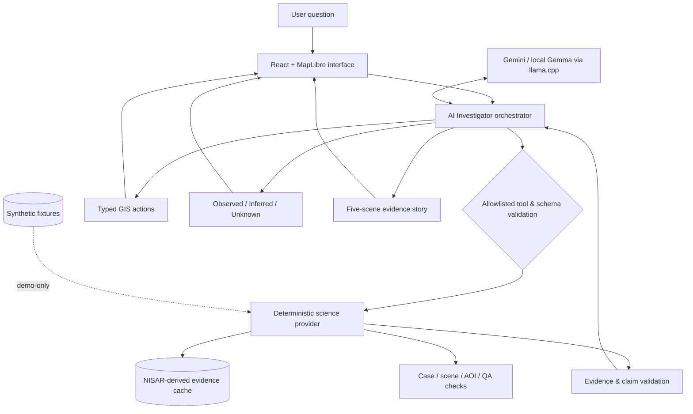

<div align="center">

# SAR2Action

### Evidence-first geospatial intelligence for a changing Earth

**Ask a question. Investigate the radar. Inspect the evidence. Understand the uncertainty.**

<p>
  
  
  
</p>

**AI-guided SAR investigation · Explainable evidence · Interactive WebGIS · Scientific storytelling**

[The challenge](#the-challenge) · [Our approach](#our-approach) · [Explore the demos](#explore-the-demos) · [Architecture](#system-architecture) · [Run locally](#run-locally) · [Scientific integrity](#scientific-integrity)

</div>

---

> **Our principle:** An AI should not just tell you *what changed*—it should show you **the observation behind the claim**, explain **how the measurement was produced**, and acknowledge **what the evidence cannot establish**.

## The challenge

Satellite radar can reveal changes in Earth's surface even when optical imagery is limited by clouds or illumination. But turning complex SAR measurements into an accessible, trustworthy explanation is difficult: users must navigate specialized products, compare observations, assess data quality, track numerical provenance, and avoid inferring causes that radar alone cannot prove.

**SAR2Action bridges the gap between an Earth-observation measurement and a defensible human understanding of it.**

## Our approach

SAR2Action is an interactive **AI Earth Investigator** built around a strict separation of concerns:

- **The language model decides which approved questions to ask and which visual actions to request.**
- **Deterministic science services provide the numbers, data-quality checks, and evidence records.**
- **Validation contracts restrict each claim to compatible observations, AOIs, methods, and evidence IDs.**
- **The WebGIS and story interface let people inspect the evidence themselves.**

Instead of letting a generative model invent satellite measurements, SAR2Action connects natural-language investigation to structured, traceable scientific outputs.

### What makes it different?

| Capability | What it means in practice |
| :--- | :--- |
| **Evidence-grounded agent** | Gemini selects allowlisted science and GIS tools; numerical answers are taken from validated tool results. |
| **Claim-to-evidence traceability** | Explanations reference evidence IDs, scene/AOI context, analysis methods, and scientific limitations. |
| **Uncertainty-aware reasoning** | Every interpretation distinguishes **Observed**, **Inferred**, and **Unknown**. |
| **Agentic WebGIS** | Investigation can focus the map, open a radar fingerprint, and display corresponding evidence through typed actions. |
| **Investigation-to-story** | A five-scene narrative connects observations, supporting evidence, map context, and unresolved questions. |
| **Explicit data boundaries** | Synthetic ranking, cached NISAR-derived evidence, and future live computation are clearly separated. |

## Explore the demos

SAR2Action currently offers **two deliberately separate demonstrations**. They show complementary capabilities and must not be presented as one fully validated live-NISAR pipeline.

| | **Demo A — NISAR-derived evidence** | **Demo B — Synthetic spatial investigation** |
| :--- | :--- | :--- |
| **Purpose** | Investigate precomputed radar measurements and their limitations. | Demonstrate automated geospatial ranking and multi-region comparison. |
| **Data** | Authorized scientific cache supplied by the science/data team. | Explicitly labeled synthetic test data. |
| **Experience** | Ask → fingerprint → evidence → map → five-scene story. | Ask → rank regions → compare → map focus → evidence → story. |
| **Key limitation** | Original HDF5 source pixels have not been independently reproduced in this workspace; real within-AOI ranking is unavailable. | Rankings **do not** represent actual NASA observations. |

When running locally:

- **Demo A:** `http://127.0.0.1:5173/?demo=A`
- **Demo B:** `http://127.0.0.1:5173/?demo=B`

> **Data availability:** The source-code repository intentionally excludes private science caches, full HDF5 scenes, model weights, and credentials. A fresh clone may show Demo A as **data unavailable** until the authorized data handoff is supplied. Demo B is the reproducible, clearly synthetic path.

## A closer look: the OKI investigation

One documented case investigates **AOI-OKI-04** in South Sumatra using a precomputed NISAR GCOV evidence record.

| Evidence field | Cached value |
| :--- | ---: |
| **Evidence ID** | `E-FLAGSHIP-OKI-004` |
| **HH backscatter change** | **−0.2128 dB** |
| **HV backscatter change** | **−0.2056 dB** |
| **Valid pixels** | **3,148,830** |
| **Reported statistic** | Median of valid **per-pixel T1 − T0** differences |
| **Provenance status** | **NISAR-derived cache — independent source verification pending** |

These values agree across the supplied evidence, fingerprint, and analysis records. Their agreement is an **internal consistency check**, **not** an independent recomputation from original satellite HDF5 files.

**What can we say?** The cached analysis reports small median differences in radar backscatter between observations.

**What can we not say?** These medians alone do **not** establish statistically significant disturbance, wildfire ignition, peat combustion, vegetation recovery, or ground subsidence. Attribution would require additional evidence, and statistical significance would require a justified reference/control and uncertainty analysis.

## System architecture



**Technology:** Python · FastAPI · `google-genai` · optional Gemma/llama.cpp · React · TypeScript · Vite · MapLibre GL JS · Pytest · Vitest · Chrome browser E2E.

### Safety and evidence contracts

The investigator is **not** given unrestricted shell access or arbitrary code execution through its science tools. Tool parameters are validated; evidence is bound to its case, AOI, scene pair, method, and source. Changing context invalidates stale results instead of silently reusing them.

A model or provider outage is surfaced to the user. **A failed live AI request is never silently represented as a successful AI investigation.**

## Run locally

> These instructions describe the reported project layout. Check the scripts and dependency declarations in your checkout for the exact supported environment. **Do not put API keys in the repository.**

**Prerequisites:** Python 3.12+, Node.js 22.12+ on the 22.x line or 24.x, npm, and (optionally) an authorized Gemini API credential. The project also supports a local Gemma/llama.cpp integration when configured.

**1. Set up the backend** (PowerShell, from the repository root):

```powershell
py -3.12 -m venv .venv
.\.venv\Scripts\Activate.ps1
python -m pip install -e '.[dev]'
python -m uvicorn backend.app.main:app --host 127.0.0.1 --port 8000
```

**2. Start the frontend** (new terminal):

```powershell
cd frontend
npm ci
npm run dev -- --host 127.0.0.1
```

Open `http://127.0.0.1:5173`.

**3. Enable Gemini if needed.** The backend reads `GEMINI_API_KEY` from its **process environment**; inject the credential using a secure local method. The project also includes a local PowerShell launcher, `scripts/start_gemini_backend.ps1`, whose configuration should be reviewed before use. Never commit the local credential file, `.env`, or logs containing secrets.

**4. Provide authorized scientific evidence for Demo A.** Place the approved cache files in `data/cache/` according to the team's handoff contract; do not commit them. Re-run the cache validation script before claiming that the data is available:

```powershell
python scripts/validate_science_cache.py --output data/cache/validation_report.json
```

### Tests

```powershell
# Backend (with the project's test dependencies installed)
python -m pytest -q

# Frontend
cd frontend
npm test
npm run build
```

Some scientific integration tests require authorized scene metadata, QA sidecars, or cached evidence and should report **SKIPPED** when those files are not present. Missing data must not be substituted with manufactured observations.

## Validation snapshot

The full development workspace's **last reported release-candidate tests** included:

| Test family | Reported result |
| :--- | :--- |
| Python | **99 passed**, 6 skipped |
| Frontend unit tests | **9 passed** |
| HTTP end-to-end | **11 / 11** |
| Chrome browser end-to-end | **7 / 7** |
| Real Gemini scientific tool evaluation | **5 / 5** |
| Cross-record scientific claims | **108 / 108** |

**Scope:** These are previously reported local results, not independently rerun from the source-only checkout. The clean release candidate has separately passed frontend build/tests and data-independent backend tests; tests requiring excluded research data are skipped or run in a temporary authorized-data environment. Model API availability can be intermittent.

## Scientific integrity

SAR2Action uses **radar backscatter** observations; backscatter changes are not automatically physical land displacement or direct evidence of a specific environmental event.

We make four explicit commitments:

1. **No fabricated measurements.** Quantitative results must originate from a deterministic analysis service or recorded evidence.
2. **No unsupported attribution.** Fire, peat combustion, vegetation recovery, and subsidence require evidence beyond backscatter differences alone.
3. **No hidden data-mode substitution.** Cached observations, synthetic fixtures, and live computation remain distinct.
4. **No silent certainty upgrades.** Incomplete provenance and absent validation remain visible to users.

**Known research blockers:** Independent source-HDF5 pixel reproduction, source-product hashes, formal significance/control-region assessment, and real georeferenced within-AOI change ranking have **not yet been completed** in the reported release.

**Private-release security limitation:** Microsoft Safety Scanner reported no infection in its final run, but its log did not identify the scanned folder. Coverage of this source-only release directory could not be independently confirmed. An earlier quick scan removed a Defender-tampering registry value; the cause remains unresolved. The release owner accepts this unverified scan coverage for this private competition release.

## Team and research workflow

| Workstream | Responsibility |
| :--- | :--- |
| **A · Science** | SAR interpretation, pair comparability, QA, and scientific claims. |
| **B · Data** | NISAR ingestion, preprocessing, deterministic metrics, cached evidence, and provenance. |
| **C · WebGIS** | Interactive maps, radar visualizations, and user-facing evidence exploration. |
| **D · AI** | Tool-restricted investigator, context/evidence validation, narratives, and agent evaluation. |

This project is a competition-oriented research prototype. It is **not affiliated with or endorsed by NASA or ISRO**. Scientific-data rights and third-party software licenses remain with their respective owners; do not assume all research datasets are redistributable.

---

<div align="center">

### From satellite signal to scientific understanding.

**What changed? · What supports the claim? · What remains unknown?**

*SAR2Action — evidence before conclusions.*

</div>
