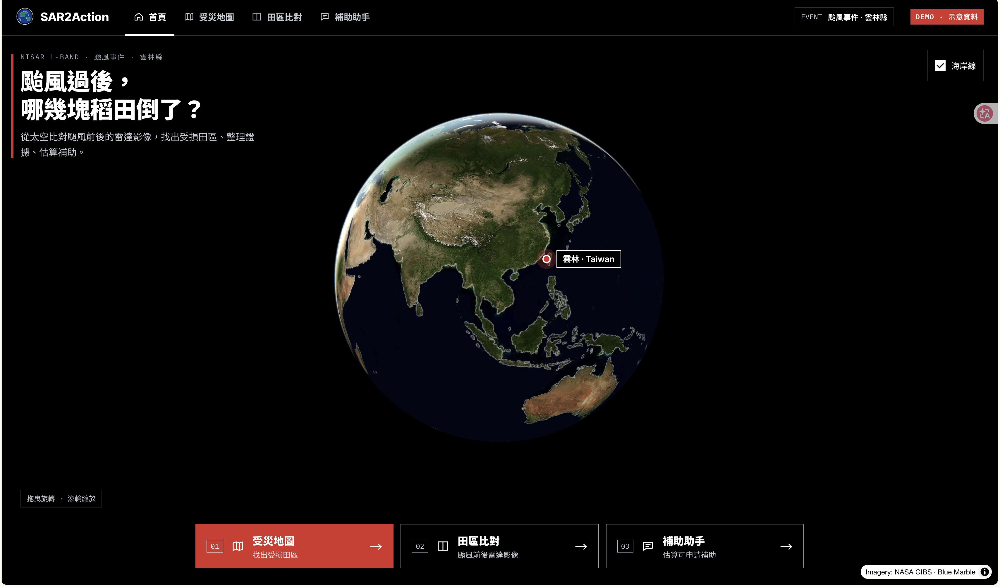
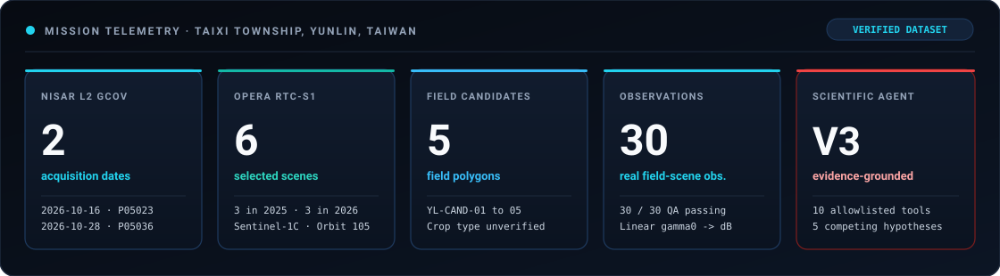
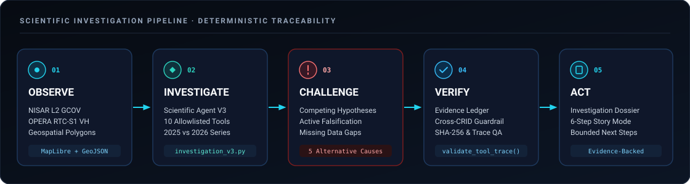
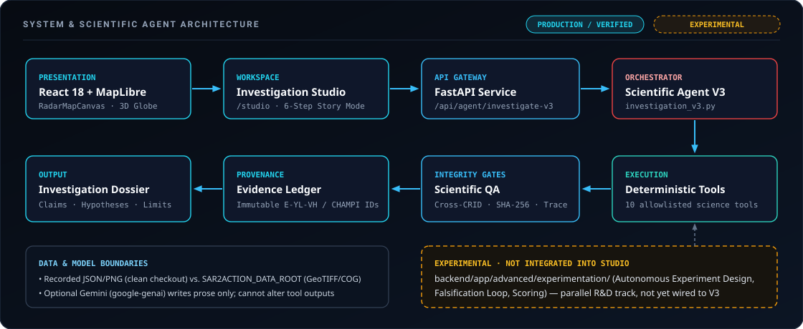
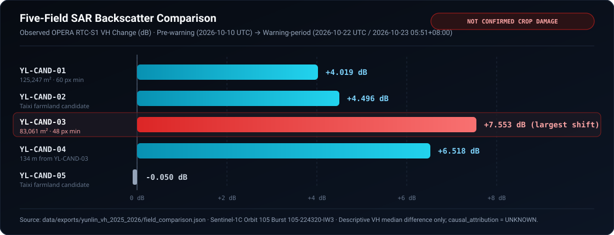

<div align="center">

<h6>SAR2ACTION · NASA SPACE APPS CHALLENGE 2026</h6>

# FROM EARTH'S SIGNALS TO SCIENTIFIC DECISIONS.

**An Evidence-Grounded AI Platform for Autonomous Earth Investigation.**

<br />



<br /><br />

*From radar observations to scientific evidence, competing hypotheses, and informed action.*

<p>
  <a href="#section-03--mission-at-a-glance">Explore the Science</a> &nbsp;·&nbsp;
  <a href="#section-05--meet-the-scientific-agent">Meet the Scientific Agent</a> &nbsp;·&nbsp;
  <a href="#section-06--real-earth-observation-evidence">Real Satellite Evidence</a> &nbsp;·&nbsp;
  <a href="#section-05--meet-the-scientific-agent">System Architecture</a> &nbsp;·&nbsp;
  <a href="#section-08--run-the-project">Get Started</a>
</p>

</div>

> **Homepage Visual Note:** The screenshot above shows the SAR2Action 3D Earth homepage using a **NASA GIBS · Blue Marble** globe basemap (not NISAR SAR imagery). While the homepage poses the motivating question (*"Which rice fields were affected after the typhoon?"*), the verified scientific dataset currently establishes **five agricultural field candidates** (`YL-CAND-01`–`05`) without yet confirming crop type or parcel-level crop loss.

---

## Section 01 — The Mission

**SAR2Action** is an autonomous, evidence-grounded Earth investigation platform built for the **NASA International Space Apps Challenge 2026 (*Dancing with the SARs*)**.

We combine **NASA NISAR L2 GCOV** and **NASA OPERA RTC-S1 (Sentinel-1C VH)** radar observations with a tool-bounded **Scientific Agent V3** and an interactive **Investigation Studio**. Every claim is traced back to verified raster measurements, deterministic quality gates, and explicit scientific uncertainty.

---

## Section 02 — Why SAR2Action Exists

Synthetic Aperture Radar (SAR) sees through typhoon clouds and darkness—but **detecting a radar change is not the same as understanding its cause**.

A shift in radar backscatter ($\gamma^0$) can reflect surface moisture, harvesting, field preparation, wind disturbance, or differences between satellite processing versions. Traditional Earth-observation viewers show pixels; **SAR2Action investigates competing explanations before recommending action**.

---

## Section 03 — Mission at a Glance

<div align="center">
  
</div>

---

## Section 04 — From Observation to Evidence

<div align="center">
  
</div>

---

## Section 05 — Meet the Scientific Agent

Unlike chat-first geospatial assistants, **Scientific Agent V3** enforces a strict boundary between deterministic science and natural-language synthesis:

- **Deterministic Scientific Tools** — All backscatter medians, pixel support counts, and temporal alignments are computed by verified Python services (`investigation_v3.py`, `agriculture_vh_evidence.py`). The LLM cannot alter or invent numbers.
- **Evidence Validation** — Every claim binds to immutable `evidence_id` records (`E-YL-VH-*`, `E-CHAMPI-*`) and CMR scene inventory metadata.
- **Competing Hypotheses** — Actively tests five alternative explanations (`harvesting`, `field_preparation`, `moisture`, `storm_disturbance`, `observation_processing`) rather than confirming user assumptions.
- **Scientific Guardrails** — Blocks cross-CRID NISAR difference claims (`SEPARATE_OBSERVATIONS_ONLY`) and fails closed if required raw rasters fail SHA-256 verification.
- **Tool Trace** — `validate_tool_trace()` enforces step-indexed, timestamped, allowlisted execution across 10 registered scientific tools.
- **Reproducible Results** — Every investigation outputs a structured **Investigation Dossier** separating *Observed*, *Supported*, *Unresolved*, and *Not Yet Validated* findings.

<div align="center">
  
</div>

<details>
<summary><strong>Inspect the 10 Allowlisted Scientific Agent V3 Tools</strong></summary>

1. `inspect_nisar_observations` — Read verified pre/post NISAR subset QA and acquisition metadata.
2. `inspect_official_loss_scope` — Read the official Ministry of Agriculture county-level loss record.
3. `test_cross_crid_compatibility` — Apply deterministic NISAR processing compatibility gate (`PROVISIONAL` vs `VALIDATED`).
4. `get_field_vh_timeseries` — Retrieve real OPERA RTC-S1 VH observations for the selected Taixi farmland candidate.
5. `check_event_temporal_alignment` — Check actual OPERA acquisitions before, during, and after Typhoon Champi.
6. `compare_seasonal_backscatter` — Compare observed 2025 and 2026 VH signals on matched acquisition geometry.
7. `evaluate_field_hypotheses` — Evaluate five competing causes without assigning crop-damage status.
8. `find_missing_observations` — Identify observation gaps and missing field-level ground truth.
9. `calculate_temporal_changes` — Compute selected-field observed VH differences with CWA warning-window timing.
10. `compare_five_fields` — Compare all five re-extracted official farmland candidates and their spatial pattern.

</details>

---

## Section 06 — Real Earth Observation Evidence

**Case Study:** Typhoon Champi (October 2026) · **Taixi Township (`10009160`), Yunlin County, Taiwan**

<div align="center">
  
</div>

### Key Scientific Guardrails &amp; Findings

- **NASA NISAR L2 GCOV (Cross-CRID Guard):** Pre-event (`2026-10-16`, CRID `P05023`, `PROVISIONAL`, 173,852 valid pixels) and post-event (`2026-10-28`, CRID `P05036`, `VALIDATED`, 110,287 valid pixels) scenes differ in processing maturity. Because cross-CRID radiometric equivalence is not established, SAR2Action displays them separately and **does not claim a verified NISAR damage difference map**.
- **NASA OPERA RTC-S1 VH (Sentinel-1C, Orbit 105, Burst `105-224320-IW3`):** Across 30 QA-passing field-scene observations (3 scenes in 2025, 3 in 2026), `YL-CAND-03` exhibits a **`+7.553 dB`** median VH increase between `2026-10-10 UTC` (pre-warning) and `2026-10-22T21:51:56Z` (**`2026-10-23 05:51:56+08:00` Taiwan time**, **during** the CWA land warning window—not pre-warning).
- **Epistemic Boundary:** This `+7.553 dB` shift is an **observed descriptive radar difference**, **NOT confirmed crop damage**. Causal attribution (`harvesting`, `field_preparation`, `moisture`, `storm_disturbance`, or `observation_processing`) remains `UNKNOWN` without parcel-level ground truth.

---

## Section 07 — Engineering &amp; Technology

| Layer | Verified Stack (`frontend/package.json` &amp; `pyproject.toml`) |
| :--- | :--- |
| **Frontend** | React `18.3.1`, TypeScript `5.6.3`, Vite `8.3.8`, MapLibre GL JS `6.18.0` |
| **Backend** | Python `>=3.12`, FastAPI `>=0.115.0`, Pydantic `>=2.9.0`, Uvicorn `>=0.30.0` |
| **AI** | `google-genai >=3.2.0,<4` (optional live mode) + deterministic Python tool runtime |
| **Geospatial** | `rasterio`, `geopandas`, `shapely`, `pyproj`, `h5py`, `numpy`, `scipy`, `asf_search` |
| **Data** | NASA NISAR L2 GCOV, NASA OPERA L2 RTC-S1 (`v1.0`), official Taiwan boundaries |
| **Testing** | `pytest` (117 clean / 22 live-data), `vitest` (20 unit), `@playwright/test` (4 Studio E2E) |

---

## Section 08 — Run the Project

### Mode A — Recorded Demo (No API Key or Raw Rasters Required)

```powershell
# 1. Start the FastAPI backend (from repository root)
py -3.12 -m venv .venv
.\.venv\Scripts\Activate.ps1
python -m pip install -e ".[dev]"
python -m uvicorn backend.app.main:app --host 127.0.0.1 --port 8000

# 2. Start the Investigation Studio frontend (new terminal)
cd frontend
npm ci
npm run dev -- --host 127.0.0.1 --port 5173
```

Open `http://127.0.0.1:5173/studio` and select **Recorded deterministic investigation** or **Recorded Gemini investigation**.

### Mode B — Live Scientific Investigation (With `SAR2ACTION_DATA_ROOT`)

Live Investigation V3 verifies SHA-256 digests on local NISAR GeoTIFFs and OPERA RTC-S1 COGs before executing tools (failing closed with HTTP `422` if raw rasters are absent). See [`.env.example`](.env.example) and [`docs/SCIENCE_DATA_BOOTSTRAP.md`](docs/SCIENCE_DATA_BOOTSTRAP.md).

```powershell
$env:SAR2ACTION_DATA_ROOT = "<path-to-sar2action-data>"
python -m uvicorn backend.app.main:app --host 127.0.0.1 --port 8000
```

---

## Section 09 — Reproducibility &amp; Scientific Integrity

Large NASA NISAR and OPERA GeoTIFF/HDF5 products are excluded from Git to respect repository limits and data-redistribution terms. Every derived statistic links to explicit scene IDs, product versions, and SHA-256 manifests:

- **Bootstrap &amp; Verification Guide:** [`docs/SCIENCE_DATA_BOOTSTRAP.md`](docs/SCIENCE_DATA_BOOTSTRAP.md) · [`scripts/bootstrap_science_data.py`](scripts/bootstrap_science_data.py)
- **Contracts &amp; Schemas:** [`SCIENCE_CONTRACT.md`](SCIENCE_CONTRACT.md) · [`EVIDENCE_SCHEMA.md`](EVIDENCE_SCHEMA.md) · [`ARCHITECTURE.md`](ARCHITECTURE.md)

```powershell
python -m scripts.bootstrap_science_data --print-sources
python -m scripts.bootstrap_science_data --data-root "<path-to-sar2action-data>" --check
```

**Verified Test Results (`D:\SAR2Action-clean`):**
Clean-checkout `pytest`: **117 passed**, 30 skipped · Live-data `pytest` (`SAR2ACTION_DATA_ROOT`): **22 passed** · Frontend `vitest`: **20 passed** · Studio Chrome E2E (`SAR2ACTION_E2E_REAL_API=1`): **4 passed**, 1 skipped (Live Gemini skipped without `GEMINI_API_KEY`).

---

## Section 10 — Roadmap &amp; Credits

**Research Roadmap (Experimental / Not Yet Integrated into Studio):**
- Autonomous Experiment Design, Falsification Loop &amp; Scoring (`backend/app/advanced/experimentation/`)
- Scientific Uncertainty Engine · Spatial Reference Matching · Active Earthdata/CMR Evidence Acquisition

**Data Attribution &amp; Disclaimer:**
Satellite observations from NASA/ISRO NISAR L2 GCOV and NASA OPERA L2 RTC-S1 (`v1.0`, Sentinel-1C); globe basemap imagery in homepage screenshot from NASA GIBS · Blue Marble; administrative/farmland boundaries and county loss records from official Taiwan sources. SAR2Action is a competition research prototype and is **not affiliated with, endorsed by, or certified by NASA or ISRO**.

<details>
<summary><strong>繁體中文摘要 (Traditional Chinese Summary)</strong></summary>

**SAR2Action — 從地球訊號到科學決策（NASA Space Apps Challenge 2026）**

- **核心理念**：結合 **NASA NISAR L2 GCOV**、**NASA OPERA RTC-S1（Sentinel-1C VH）** 與 **Scientific Agent V3**，不直接把雷達訊號變化當成農損結論，而是透過 10 個確定性科學工具主動檢驗五種競爭假說。
- **真實案例（2026 台灣雲林台西・Champi 颱風研究區）**：
  - **NISAR**：`2026-10-16`（`P05023 PROVISIONAL`）與 `2026-10-28`（`P05036 VALIDATED`）因跨 CRID 輻射一致性尚未驗證，系統主動封鎖差異歸因推論。
  - **Sentinel-1 OPERA VH**：`YL-CAND-03` 於台灣時間 `2026-10-23 05:51:56`（颱風警報期間）觀測到 `+7.553 dB` 描述性變化，明確標註為**已觀測雷達變化，而非已確認農損**。

</details>
