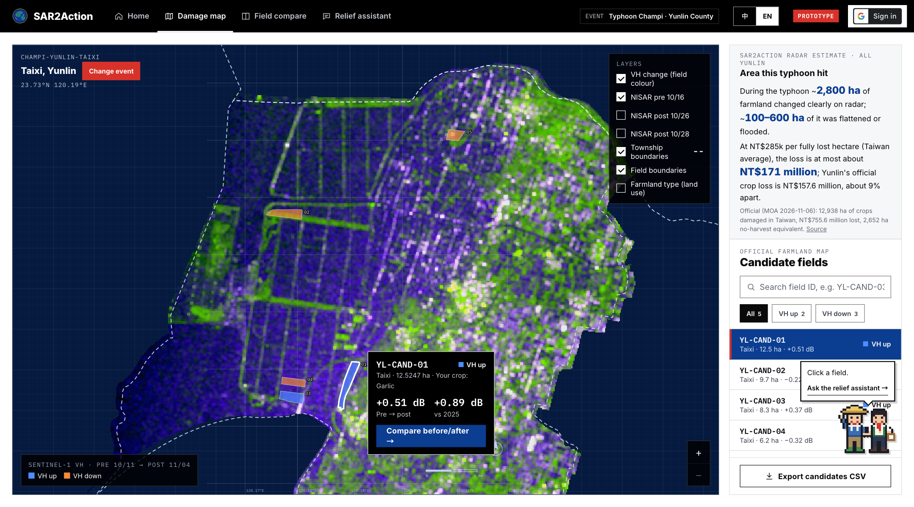
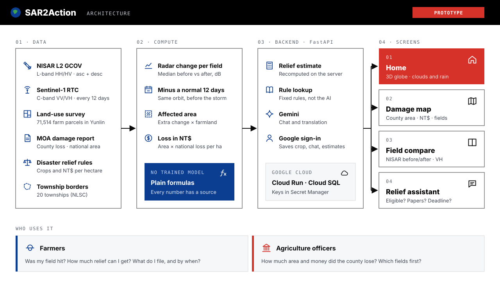
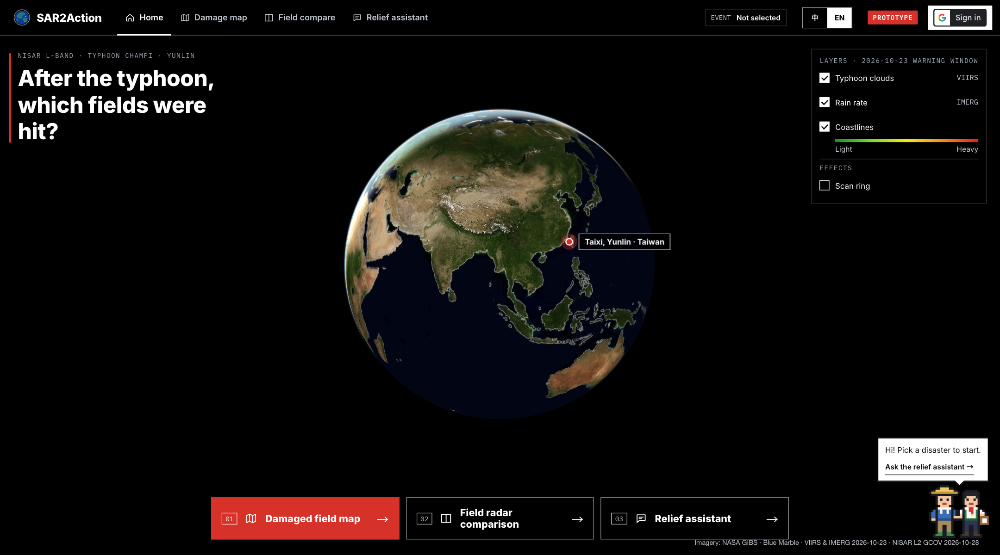
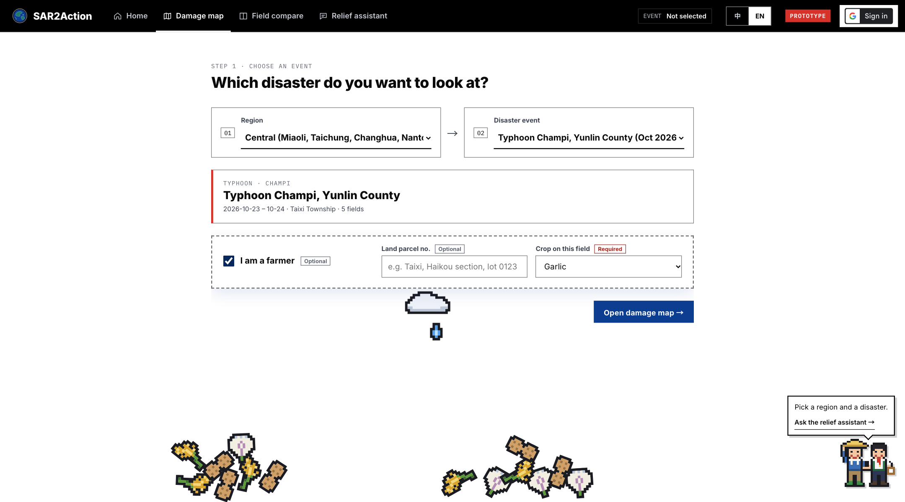
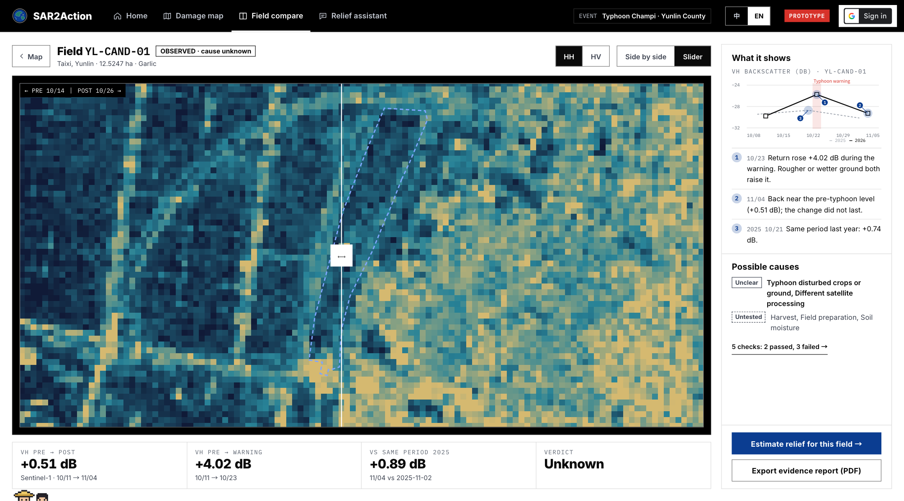
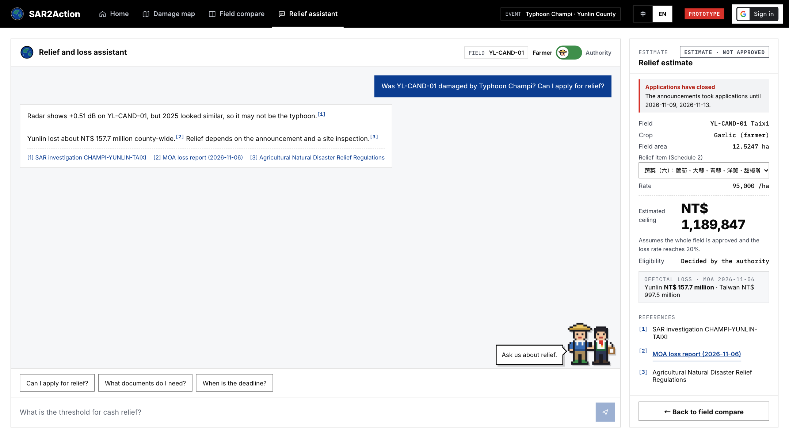

<div align="center">

<p><b>English</b> &nbsp;|&nbsp; <a href="README.zh-TW.md">中文</a></p>

<h6>SAR2ACTION · NASA SPACE APPS CHALLENGE 2026 · DANCING WITH THE SARS</h6>

# SAR2Action · Crop damage area and loss

**Radar tells us how much farmland a typhoon hit and roughly what it cost. Then we tell farmers what relief they can apply for.**

[Live site](https://sar2action-cd27vrua4a-de.a.run.app) · [Architecture](#1-the-problem-and-how-it-works) · [Home](#2-home) · [Damage map and field compare](#3-damage-map-and-field-compare) · [Relief assistant](#4-relief-assistant) · [Run it](#run-it-locally)



https://github.com/user-attachments/assets/6068ceac-13d7-4829-bceb-581330ae08d3

<sub>30-second demo</sub>

</div>

---

**Dancing with the SARs: Evidence-first AI for a changing Earth**<br />
Team: **SARAPHIM** &nbsp;·&nbsp; Members: Shao-Chieh Tseng · Hong-Cheng Chen · Zhi-Jia Huang · Chen-Yuan Xie

---

## 1. The problem and how it works

**After a typhoon, township staff check crop damage field by field, which takes a lot of people and time. Farmers who want relief have to dig the rules out of notices, regulations and tables, and it's a lot to sort through.**

SAR2Action handles both. NASA NISAR and Sentinel-1 radar give a county-wide estimate of damaged area and loss, so officers know where to look first. The relief rules are turned into Q&A and an estimate, so farmers know what they can apply for, what to bring and when it closes.



| Layer | What's in it |
| :--- | :--- |
| Data | NASA/ISRO NISAR L2 GCOV, Sentinel-1 RTC, Taiwan's land-use survey (71,514 farm parcels in Yunlin), the Ministry of Agriculture (MOA) damage report, the disaster relief regulations, NLSC township borders |
| Math | Radar change on each field before vs after the typhoon, minus what a normal 12 days on the same orbit looks like, times farmland area and Taiwan's loss per hectare. Formulas only, no trained model |
| Backend | FastAPI: relief estimate (recomputed on the server), rule lookup (fixed rules), Gemini for chat and translation, Google sign-in |
| Frontend | React + Vite + MapLibre, Chinese and English |
| Hosting | Google Cloud Run, Cloud SQL, Secret Manager |

---

## 2. Home



A 3D globe marks where the event happened. You can turn on the VIIRS cloud image and IMERG rainfall from the day of the typhoon. The three buttons at the bottom go to the damage map, field compare and the relief assistant.

---

## 3. Damage map and field compare

### Pick an event



Pick a region and a disaster event. Farmers can tick "I am a farmer" and add their crop and land number. If you're signed in, it's remembered next time.

### Damage map

The panel on the right sums up the typhoon in two sentences:

> During the typhoon ~**2,800 ha** of farmland changed clearly on radar; ~**100–600 ha** of it was flattened or flooded.<br />
> At NT$285k per fully lost hectare (Taiwan average), the loss is at most about **NT$171 million**; Yunlin's official crop loss is NT$157.6 million, about 9% apart.

- **2,800 ha**: Sentinel-1. Farmland that changed by more than 2 dB during the typhoon, beyond what a normal 12 days changes.
- **100–600 ha**: NISAR L-band. Fields where HH got 3 dB to 2 dB darker, beyond a normal 12 days. The descending pass (orbit 061) covers the north and east, the ascending pass (orbit 039) covers the south. That's 99% of the county's farmland.
- **NT$171 million**: Taiwan's crop loss (NT$755.6M) ÷ its no-harvest area (2,652 ha) ≈ NT$285k per hectare, times 600 ha. We only use national numbers, not Yunlin's NT$157.6M, so comparing the two is fair.

On the map you can switch NISAR false-colour images from before and after (R=HH, G=HV, B=HH−HV), township borders (dashed), field borders and land-use farm types.

### Field compare



Click a candidate field to see NISAR before and after. Drag the slider: 10/14 (before) is on the left, 10/26 (after) on the right. Put the line through the field (blue dashed outline) and you can see the change on the same field right away. You can switch HH/HV or go side by side. Both passes are ascending and cover all of Taixi. On the right: the field's Sentinel-1 VH time series, how it compares to the same time last year, and the causes we can't rule out yet.

---

## 4. Relief assistant



- **Ask**: "Can I apply for relief?", "What documents do I need?", "When is the deadline?". Every answer points to its source: the radar check, the MOA loss report or the regulation itself.
- **Estimate**: the right panel matches your crop to its relief item and rate (garlic is Vegetables (6), NT$95,000 per hectare), works out a ceiling and warns you about the deadline. The server recomputes the amount from the current regulation, so the page can't change it.
- **Two views**: switch between Farmer and Authority at the top. Each gets the answer it needs.
- **What the AI does**: Gemini handles the conversation and English translation. Looking up the rules and calculating money are fixed rules, not left to the model.
- **Sign in**: with Google, it saves your crop, your questions and any estimate you save.

The relief item names come straight from the regulation's table, so they stay in Chinese.

---

## Run it locally

You need Python 3.12 and Node 22.

```bash
# Backend (repo root)
python3.12 -m venv .venv && source .venv/bin/activate
pip install -e ".[dev]"
uvicorn backend.app.main:app --host 127.0.0.1 --port 8000

# Frontend (another terminal)
cd frontend
npm ci
npm run dev        # http://localhost:5173
```

- **Gemini**: set `GEMINI_API_KEY` in `.env` (see [`.env.example`](.env.example)) and `SAR2ACTION_LLM_PROVIDER=gemini`. Without them it still runs; answers come from fixed rules.
- **Google sign-in**: set `GOOGLE_OAUTH_CLIENT_ID`. Locally, `SAR2ACTION_USER_STORE=memory` skips the database.
- **Tests**: `npm test` (frontend), `pytest` (backend).
- **Deploy**: see [`docs/DEPLOY_CLOUD_RUN.md`](docs/DEPLOY_CLOUD_RUN.md).

### Recompute the radar numbers

Big NISAR and Sentinel-1 files aren't in Git. The scripts only read the area they need. NISAR uses the Earthdata login in `~/.netrc`.

```bash
# Sentinel-1: county-wide affected area (Planetary Computer)
python scripts/estimate_yunlin_damage_area.py <yunlin_farmland.shp> data/exports/yunlin_damage_area 105

# NISAR: flattened/flooded area for the county and each township
python scripts/estimate_yunlin_nisar_change.py <yunlin_farmland.shp> <yunlin_towns.gpkg> <h5 dir> data/exports/yunlin_nisar_change

# NISAR images for the map and field compare
python scripts/render_nisar_map.py --ascending-pair <10/14 granule URL> <10/26 granule URL>

# Architecture diagrams (Chinese and English)
python docs/readme-assets/architecture.py
```

Results go to `data/exports/`, with a CSV of every field's change.

---

## Data and disclaimer

- NASA/ISRO NISAR L2 GCOV (ASF DAAC, Earthdata Cloud)
- ESA Sentinel-1 GRD, processed by Microsoft Planetary Computer `sentinel-1-rtc` (CC-BY-4.0)
- NASA GIBS (Blue Marble, VIIRS), GPM IMERG
- NLSC land-use survey and township borders
- MOA Typhoon Champi agricultural damage report (2026-11-06), Agricultural Natural Disaster Relief Regulations

Radar change isn't confirmed crop damage. The township's field inspection and the authority's decision are what count. SAR2Action is a competition prototype and isn't affiliated with or endorsed by NASA or ISRO.
