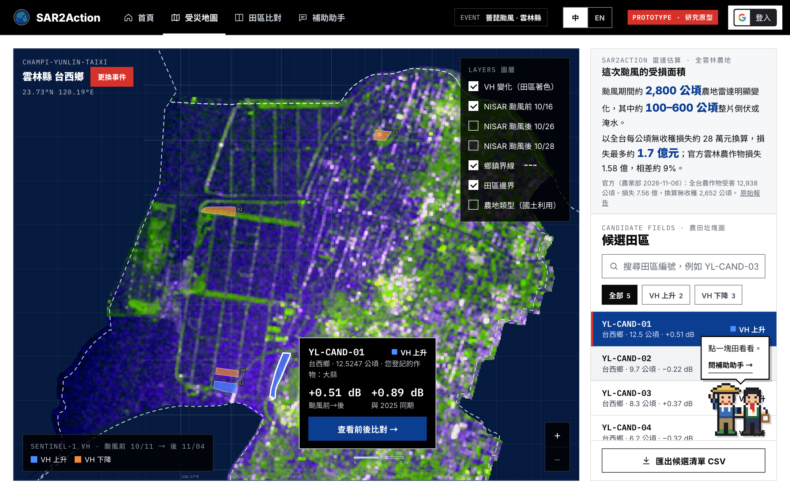
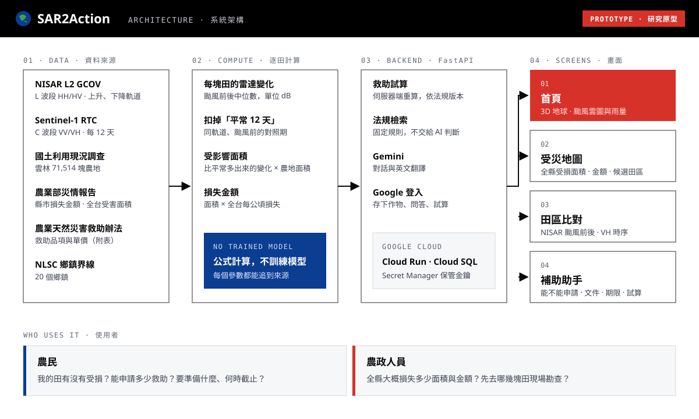
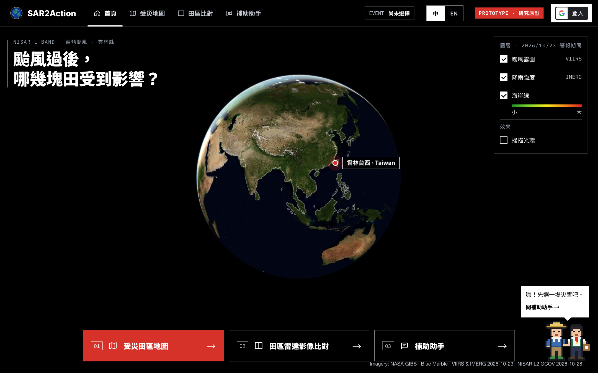
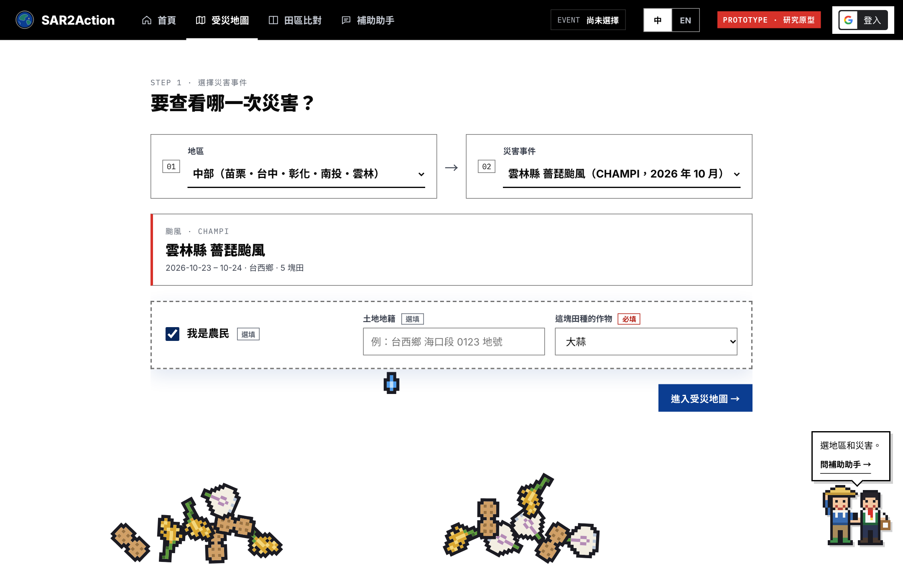
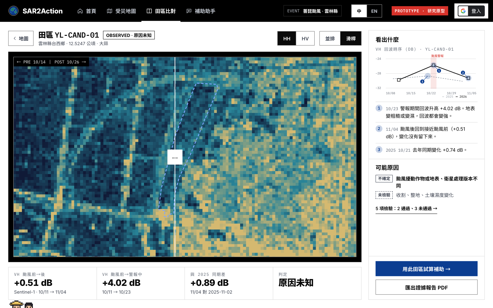
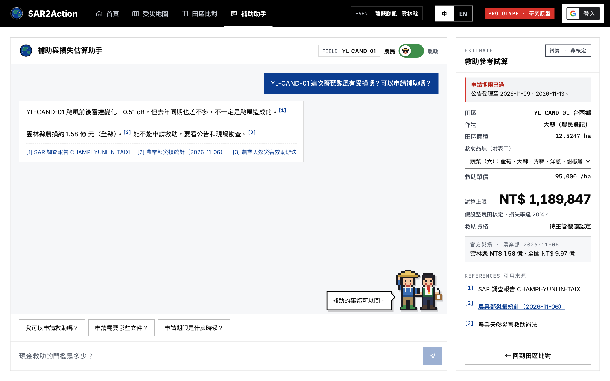

<div align="center">

<p><a href="README.md">English</a> &nbsp;|&nbsp; <b>中文</b></p>

<h6>SAR2ACTION · NASA SPACE APPS CHALLENGE 2026 · DANCING WITH THE SARS</h6>

# SAR2Action · 受損面積與金額評估

**用衛星雷達估算颱風後的農地受損面積與金額，再告訴農民能申請什麼救助。**

[線上版本](https://sar2action-cd27vrua4a-de.a.run.app) · [架構](#1-痛點與架構) · [首頁](#2-首頁) · [受災地圖與田區比對](#3-受災地圖與田區比對) · [補助助手](#4-補助助手) · [本機執行](#本機執行)



https://github.com/user-attachments/assets/4e9cb46c-01b4-4c88-bd6a-26e1a823701e

<sub>30 秒示範影片（英文配音與字幕）</sub>

</div>

---

**Dancing with the SARs: Evidence-first AI for a changing Earth**<br />
團隊：**SARAPHIM** &nbsp;·&nbsp; 成員：曾少杰 · 陳鴻程 · 黃智佳 · 謝宸源

---

## 1. 痛點與架構

**颱風過後，農損要靠公所人員一塊一塊田去勘查，人力和時間都吃緊。農民要申請救助，又得自己從公告、法規和附表裡找規則，資訊多又雜。**

SAR2Action 把兩件事接起來：用 NASA NISAR 和 Sentinel-1 雷達估算全縣受損面積與金額，讓農政人員知道先去哪裡；再把救助法規整理成問答和試算，讓農民知道能申請什麼、要準備什麼、何時截止。



| 層 | 內容 |
| :--- | :--- |
| 資料 | NASA/ISRO NISAR L2 GCOV、Sentinel-1 RTC、國土利用現況調查（雲林 71,514 塊農地）、農業部災情報告、農業天然災害救助辦法、NLSC 鄉鎮界線 |
| 計算 | 每塊田颱風前後的雷達變化，扣掉同軌道「平常 12 天」的變化，再乘上農地面積與全台每公頃損失。全部是公式，不訓練模型 |
| 後端 | FastAPI：救助試算（伺服器端重算）、法規檢索（固定規則）、Gemini 對話與翻譯、Google 登入 |
| 前端 | React + Vite + MapLibre，中英雙語 |
| 部署 | Google Cloud Run、Cloud SQL、Secret Manager |

---

## 2. 首頁



首頁用 3D 地球標出事件位置，可以疊上颱風當天的 VIIRS 雲圖和 IMERG 降雨強度。下方三個入口分別通往受災地圖、田區比對和補助助手。

---

## 3. 受災地圖與田區比對

### 選擇災害事件



先選地區和災害事件。農民可以勾選「我是農民」，填上作物和地籍；登入後會記住，下次直接帶入。

### 受災地圖

右上角一段話說明這次颱風的規模：

> 颱風期間約 **2,800 公頃**農地雷達明顯變化，其中約 **100–600 公頃**整片倒伏或淹水。<br />
> 以全台每公頃無收穫損失約 28 萬元換算，損失最多約 **1.7 億元**；官方雲林農作物損失 1.58 億，相差約 9%。

- **2,800 公頃**：Sentinel-1，颱風期間變化超過 2 dB 的農地，比平常 12 天多出來的部分。
- **100–600 公頃**：NISAR L 波段，每塊田 HH 變暗超過 3 dB 到 2 dB、比平常多出來的部分。下降軌道（061）涵蓋縣北、縣東，上升軌道（039）補縣南，全縣 99% 的農地都有量到。
- **1.7 億元**：全台農作物損失 7.56 億 ÷ 換算無收穫 2,652 公頃 ≈ 每公頃 28.5 萬元，乘上 600 公頃。只用全台數字，不拿雲林的 1.58 億調參數，所以兩者可以拿來比。

地圖上可以切換 NISAR 颱風前後的假色影像（R=HH、G=HV、B=HH−HV）、鄉鎮界線（虛線）、田區邊界和國土利用農地類型。

### 田區比對



點一塊候選田就能看颱風前後的 NISAR 影像。拖動中間的滑桿，左邊是 10/14 颱風前，右邊是 10/26 颱風後；分界線切過田區（藍色虛線），同一塊田前後的差別一眼就看得出來。HH、HV 都能切換，也可以改成並排。兩期都是上升軌道，整個台西鄉都有拍到。右側列出這塊田的 Sentinel-1 VH 時序、跟去年同期的差異，以及還沒排除的可能原因。

---

## 4. 補助助手



- **問答**：農民可以直接問「我可以申請救助嗎？」「要哪些文件？」「期限是什麼時候？」。每句回答都標出來源：雷達調查、農業部災損統計，或救助辦法條文。
- **試算**：右側依作物對應救助品項和單價（例如大蒜屬蔬菜（六），每公頃 95,000 元），算出試算上限，並提醒申請期限。金額由伺服器依法規版本重算，前端不能改。
- **兩種角色**：上方切換「農民」或「農政」，回答的重點不同。
- **AI 的分工**：Gemini 負責對話和英文翻譯；法規檢索與金額計算是固定規則，不交給模型判斷。
- **登入**：用 Google 登入後，會存下你填的作物、問答紀錄和按下儲存的試算。

---

## 本機執行

需要 Python 3.12 和 Node 22。

```bash
# 後端（repo 根目錄）
python3.12 -m venv .venv && source .venv/bin/activate
pip install -e ".[dev]"
uvicorn backend.app.main:app --host 127.0.0.1 --port 8000

# 前端（另開一個終端機）
cd frontend
npm ci
npm run dev        # http://localhost:5173
```

- **Gemini**：在 `.env` 設 `GEMINI_API_KEY`（參考 [`.env.example`](.env.example)），並設 `SAR2ACTION_LLM_PROVIDER=gemini`。沒有設也能跑，問答改用固定規則回答。
- **Google 登入**：設 `GOOGLE_OAUTH_CLIENT_ID`；本機可用 `SAR2ACTION_USER_STORE=memory`，不需要資料庫。
- **測試**：`npm test`（前端）、`pytest`（後端）。
- **部署**：見 [`docs/DEPLOY_CLOUD_RUN.md`](docs/DEPLOY_CLOUD_RUN.md)。

### 重算雷達估算

大型 NISAR、Sentinel-1 檔案不放進 Git。腳本只讀需要的範圍，NISAR 用 `~/.netrc` 裡的 Earthdata 帳號。

```bash
# Sentinel-1：全縣受影響面積（Planetary Computer）
python scripts/estimate_yunlin_damage_area.py <雲林農地.shp> data/exports/yunlin_damage_area 105

# NISAR：全縣、各鄉鎮的倒伏/淹水面積
python scripts/estimate_yunlin_nisar_change.py <雲林農地.shp> <雲林鄉鎮.gpkg> <h5 目錄> data/exports/yunlin_nisar_change

# NISAR 地圖與田區比對影像
python scripts/render_nisar_map.py --ascending-pair <10/14 granule URL> <10/26 granule URL>

# 架構圖（中、英文）
python docs/readme-assets/architecture.py
```

結果在 `data/exports/`，每塊田的變化量都有 CSV。

---

## 資料來源與聲明

- NASA/ISRO NISAR L2 GCOV（ASF DAAC，Earthdata Cloud）
- ESA Sentinel-1 GRD，經 Microsoft Planetary Computer `sentinel-1-rtc` 處理（CC-BY-4.0）
- NASA GIBS（Blue Marble、VIIRS）、GPM IMERG
- 國土測繪中心國土利用現況調查、鄉鎮市區界線
- 農業部薔琵颱風農業災情報告（2026-11-06）、農業天然災害救助辦法

雷達變化不等於確定的農損，最後仍以公所現場勘查和主管機關認定為準。SAR2Action 是比賽用的研究原型，與 NASA、ISRO 沒有隸屬或背書關係。
